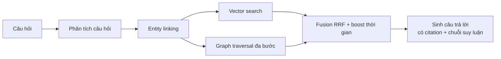

# GraphRAG Hỏi đáp Lịch sử Việt Nam

Hệ thống hỏi đáp lịch sử Việt Nam (905–1975) dựa trên **Knowledge Graph kiểu event-centric** kết hợp **truy xuất lai** (vector + đồ thị đa bước), có căn cứ truy vết và giải thích được chuỗi liên kết logic.

> **Trạng thái:** đang trong giai đoạn thiết kế. Tài liệu ở [`docs/`](docs/); chưa có code triển khai.

## Tài liệu

| Tài liệu | Nội dung |
|---|---|
| [`docs/00_tong_quan.md`](docs/00_tong_quan.md) | Bài toán, mục tiêu, phạm vi, kiến trúc tổng quan |
| [`docs/01_phan_tich_du_lieu.md`](docs/01_phan_tich_du_lieu.md) | Phân tích dữ liệu thực tế đã đo, quyết định chọn nguồn |
| [`docs/02_kien_truc.md`](docs/02_kien_truc.md) | Module, schema KG, hạ tầng Docker, cấu trúc repo |
| [`docs/03_thuat_toan_truy_xuat.md`](docs/03_thuat_toan_truy_xuat.md) | Thuật toán truy xuất, scoring, entity resolution, sinh đáp án |
| [`docs/04_danh_gia.md`](docs/04_danh_gia.md) | Bộ câu hỏi, metrics, baseline, ablation, phân tích lỗi |
| [`docs/05_ke_hoach_thuc_hien.md`](docs/05_ke_hoach_thuc_hien.md) | Lộ trình, phân công, ngân sách thời gian, thứ tự cắt |
| [`docs/06_quyet_dinh_thiet_ke.md`](docs/06_quyet_dinh_thiet_ke.md) | Nhật ký quyết định + **các câu hỏi còn đang thảo luận** |

## Tóm tắt thiết kế

- **Ontology**: 35 event type + 11 argument role + quan hệ temporal/causal lấy từ bộ dữ liệu VHE.
- **KG**: Neo4j (Docker), mọi edge đều truy vết được về chunk nguồn.
- **Vector store**: Qdrant (Docker), có payload filter theo năm.
- **Đánh giá**: ~180 câu chia 4 nhóm (single-hop / multi-hop / temporal / out-of-KB), so sánh LLM-only, Vanilla RAG, RAG+Graph, và hệ thống đề xuất; 7 ablation; CI 95% + McNemar.

## Yêu cầu môi trường (đã kiểm chứng)

- Python 3.12 + [`uv`](https://docs.astral.sh/uv/)
- Docker + Docker Compose (Neo4j, Qdrant)
- `GEMINI_API_KEY` trong file `.env`
- Kaggle tài khoản (cho embedding / fine-tune)

## Tài liệu liên quan

- VHE: [hoangthuytruc/vhe-dataset](https://github.com/hoangthuytruc/vhe-dataset) · [PACLIC 2024](https://aclanthology.org/2024.paclic-1.59/)
- HisGraphRAG: [PACLIC 2025](https://aclanthology.org/2025.paclic-1.49/)
- Tree-KG (KG từ SGK THPT): [arXiv 2609.00763](https://arxiv.org/html/2609.00763)
- VN-MTEB (chọn embedding tiếng Việt): [arXiv 2507.21500](https://arxiv.org/html/2507.21500v1)
