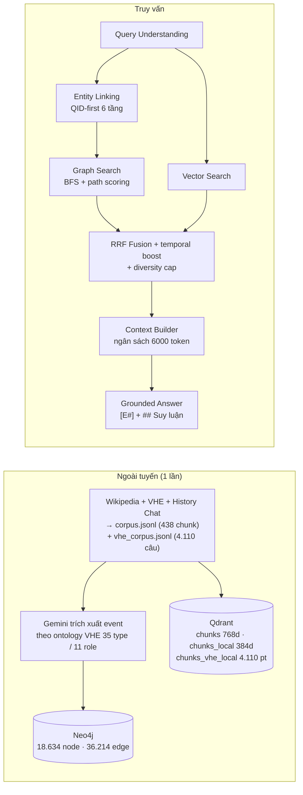

# Vietnamese History GraphRAG (905–1975)

Hệ thống **GraphRAG hỏi đáp lịch sử Việt Nam** (giai đoạn 905–1975): dựng Knowledge Graph
theo ontology VHE từ Wikipedia tiếng Việt + VHE + History Chat, truy xuất **hybrid**
(vector + đồ thị), và sinh câu trả lời **có trích dẫn `[E#]`** kèm chuỗi suy luận và
subgraph để kiểm chứng.

> Đồ án môn Xử lý Ngôn ngữ Tự nhiên. Toàn bộ thiết kế nằm trong [`docs/`](docs/).

---

## 1. Tính năng chính

| Năng lực | Mô tả |
|---|---|
| **Single-hop / multi-hop QA** | Truy vấn đồ thị BFS 1–3 hop, chấm điểm đường đi 4 yếu tố |
| **Grounded answering** | Chỉ dùng evidence, mỗi mệnh đề gắn `[E#]`, từ chối trả lời khi thiếu căn cứ |
| **Giải thích kiểm chứng** | Chuỗi suy luận + đường đi KG + subgraph vẽ được trên UI |
| **Baseline & ablation** | B0 (LLM-only), B1 (Vanilla RAG), B2 (RAG+Graph) + 7 cờ ablation |
| **Đánh giá định lượng** | Token-F1, ROUGE-L, Groundedness, Citation P/R, Path Hit, nDCG + bootstrap CI 95% + McNemar |
| **Giao diện demo** | Streamlit 5 tab: Hỏi đáp · Truy vết KG · Đồ thị · Đánh giá · Hệ thống |

## 2. Kiến trúc (rút gọn)



Chi tiết: [`docs/02_kien_truc.md`](docs/02_kien_truc.md),
[`docs/03_thuat_toan_truy_xuat.md`](docs/03_thuat_toan_truy_xuat.md),
[`docs/07_xac_dinh_thuc_the.md`](docs/07_xac_dinh_thuc_the.md).

## 3. Cài đặt

### 3.1 Yêu cầu

* Python **3.12**
* Docker (Neo4j 5.26 + Qdrant 1.12.4)
* Gemini API key (free tier dùng được, có cache đĩa + xoay model khi hết quota)

### 3.2 Các bước

```bash
# 1) dependency
python -m venv .venv && source .venv/bin/activate
pip install -e .            # hoặc: pip install -r requirements.txt

# 2) cấu hình
cp .env.example .env        # rồi điền GEMINI_API_KEY, NEO4J_PASSWORD

# 3) bật dịch vụ
bash scripts/00_up.sh       # Neo4j :7687/:7474, Qdrant :6333

# 4) chạy toàn bộ pipeline
bash scripts/run_all.sh
```

### 3.3 Chạy từng bước

| Bước | Lệnh | Đầu ra |
|---|---|---|
| 1 | `python scripts/01_ingest.py` | `data/processed/corpus.jsonl` + `vhe_corpus.jsonl` |
| 2 | `python scripts/03_build_kg.py --vhe` | Neo4j (đồ thị con VHE gold + đồ thị Wikipedia) + `artifacts/kg_stats.json` |
| 3 | `python scripts/04_embed.py` | Qdrant `chunks` / `chunks_local` / `chunks_vhe_local` + `artifacts/embed_stats*.json` |
| 4 | `python scripts/05_eval_dataset.py` | `data/processed/eval_questions.jsonl` (150 câu) |
| 5 | `python scripts/10_validate_eval_paths.py` | `artifacts/eval_path_validation.json` (gold path ↔ KG) |
| 6 | `python scripts/06_ask.py "câu hỏi"` | câu trả lời + `[E#]` + subgraph |
| 7 | `python scripts/07_run_eval.py` | `reports/results.csv`, `reports/results.md`, `reports/figures/` |
| 8 | `bash scripts/08_smoke_test.sh` | kiểm tra offline toàn hệ thống |
| 9 | `python scripts/09_live_check.py` | kiểm tra dịch vụ thật (Gemini/Neo4j/Qdrant) |
| — | `streamlit run src/hgrag/app/streamlit_app.py` | giao diện demo 5 tab |

Mọi bước **idempotent** và **có cache**: chạy lại không tốn tiền LLM.

## 4. Cấu trúc repo

```
vietnam_history_graphrag/
├── configs/default.yaml           # toàn bộ tham số (ghi đè bằng biến môi trường)
├── docker-compose.yml             # Neo4j 5.26 + Qdrant 1.12.4
├── docs/                          # 8 tài liệu thiết kế (00–07)
├── src/hgrag/
│   ├── config.py                  # Settings: YAML + env override
│   ├── llm/       client.py schemas.py prompts.py
│   ├── data/      wikipedia.py vhe.py history_chat.py chunking.py normalize.py wikidata.py ingest.py
│   ├── kg/        ontology.py labels.py alias.py extractor.py builder.py store.py vhe_gold.py
│   ├── retrieval/ embeddings.py vector_store.py entity_linker.py graph_search.py fusion.py context.py rerank.py lexical.py
│   ├── qa/        query_understanding.py answer.py explain.py pipeline.py
│   ├── eval/      dataset.py dataset_builder.py metrics.py judge.py run_eval.py report.py error_analysis.py
│   └── app/       streamlit_app.py
├── scripts/       00_up.sh 00_down.sh 01_ingest.py 03_build_kg.py 04_embed.py
│                  05_eval_dataset.py 06_ask.py 07_run_eval.py 08_smoke_test.sh
│                  09_live_check.py 10_validate_eval_paths.py 11_fix_eval_paths.py run_all.sh
├── tests/         test_data.py test_llm.py test_kg.py test_retrieval.py test_qa.py test_eval.py test_app.py
├── data/          raw/ processed/
├── artifacts/     llm_cache/ extractions/ *.json
└── reports/       results.csv results.md figures/ error_analysis.md
```

## 5. Định danh thực thể (QID-first)

Sáu tầng (T0–T5), dừng sớm khi đủ tin cậy:

| Tầng | Nguồn | Điểm |
|---|---|---|
| T0 | QID đã biết / node đã có trong KG | `1.00` |
| T1 | Wikidata alias tiếng Việt (`skos:altLabel[vi]`, `wbsearchentities`) | `0.97` |
| T2 | Wikipedia `prop=redirects` | `0.93` |
| T3 | LLM xác minh redirect (`task="verify_alias"`) | `0.90` |
| T4 | Chuẩn hóa chuỗi (bỏ dấu, bỏ honorific, NFC) | `0.85` |
| T5 | Embedding top-k + lọc miền (P31 / P27 / trùng thời gian) + LLM phân giải | `0.60–0.90` |

Chi tiết đầy đủ: [`docs/07_xac_dinh_thuc_the.md`](docs/07_xac_dinh_thuc_the.md).

## 6. Đánh giá

Bộ câu hỏi 150 câu từ 4 nguồn (`vhe_template`, `llm_from_wiki`, `history_chat`,
`out_of_kb`), chia 4 nhóm (`single_hop`, `multi_hop`, `temporal`, `out_of_kb`).
Gold path của 121 câu đã được **chuẩn hoá theo KG thật** (97,7% exact match).

```bash
python scripts/07_run_eval.py                 # đầy đủ (B0/B1/B2/Ours + 7 ablation)
python scripts/07_run_eval.py --limit 20      # chạy nhanh
python scripts/07_run_eval.py --mock --limit 5   # offline
```

Kết quả: [`reports/results.md`](reports/results.md) ·
[`reports/results.csv`](reports/results.csv) ·
[`reports/error_analysis.md`](reports/error_analysis.md).

## 7. Kiểm thử

```bash
.venv/bin/python -m pytest -q          # toàn bộ unit test (offline, không gọi mạng)
bash scripts/08_smoke_test.sh          # smoke test end-to-end
.venv/bin/python scripts/09_live_check.py   # kiểm tra dịch vụ thật
```

Test tự động chặn network (fixture `block_network`); test cần mạng phải đánh dấu
`@pytest.mark.network`.

## 8. Ghi chú về quota Gemini (free tier)

* Mỗi model Flash có quota ~20 request/ngày → client **xoay model** khi gặp HTTP 429,
  và **ghi nhớ** model đã cạn (`_exhausted_models`) để không phải trả giá một lần gọi
  thất bại cho mỗi request.
* **Quota embedding là độc lập** với quota chat. Khi model embedding chính hết quota,
  client **fail fast** (không ngủ tới lúc reset ~20 giờ) rồi **chuyển sang model
  embedding dự phòng**; nếu mọi model embedding đều cạn thì dùng model **cục bộ**
  `paraphrase-multilingual-MiniLM-L12-v2` (384 chiều) và corpus được embed lại
  bằng đúng model mới để không gian vector nhất quán.
* **Reranker**: `bge-reranker-v2-m3` mất ~35 s/lần gọi trên CPU. `rerank_backend: auto`
  tự phát hiện CUDA → có GPU dùng cross-encoder, không có GPU dùng heuristic reranker.
* Mọi lời gọi LLM **và embedding** được cache đĩa tại `artifacts/llm_cache/`
  (khoá theo nội dung + model) → chạy lại **không tốn quota**.
* Run đánh giá dài hỗ trợ **checkpoint + resume**:
  ```bash
  python scripts/07_run_eval.py --checkpoint artifacts/eval_checkpoint.json
  ```
  Khi bị 429 giữa chừng, chạy lại lệnh trên sẽ bỏ qua các cặp `(system, qid)`
  đã chấm xong.
* Nếu hết quota toàn bộ: hệ thống tự chuyển sang chế độ **mock** (offline) để vẫn demo được.

## 9. Giấy phép / ghi nhận

* Nội dung lịch sử: Wikipedia tiếng Việt (CC BY-SA 4.0), tập VHE, Vietnam History Chat.
* Mô hình: Google Gemini (free tier).
