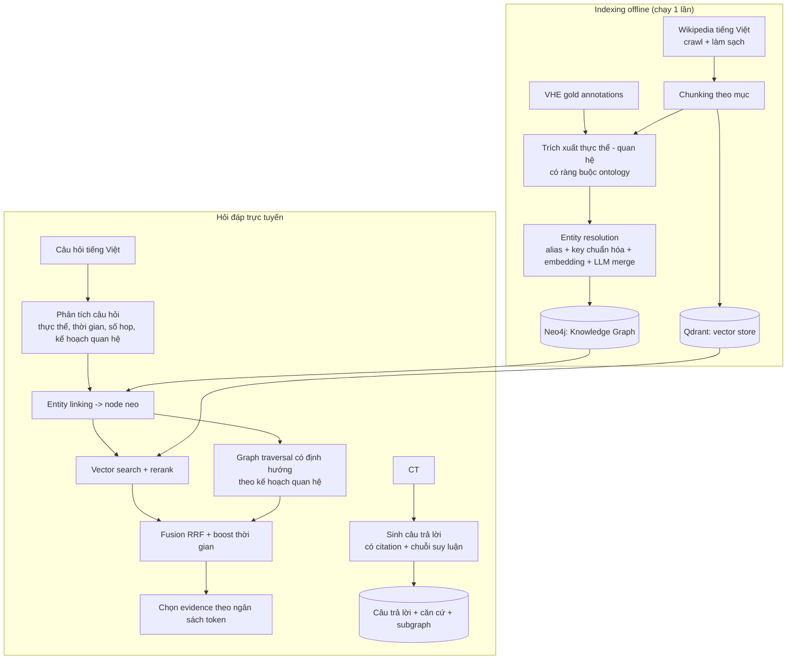

# GraphRAG Hỏi đáp Lịch sử Việt Nam — Tổng quan đồ án

> Trạng thái: **tài liệu thiết kế (draft để thảo luận)** — chưa triển khai code.
> Cập nhật: 2026-11-01

## 1. Bối cảnh và vấn đề

Hệ thống hỏi đáp lịch sử bằng RAG thuần (chỉ tìm kiếm ngữ nghĩa) gặp hai vấn đề rõ ràng trong miền lịch sử:

1. **Câu hỏi nhiều bước (multi-hop)**: "Ngô Quyền đánh thắng ai, và người đó là con của ai vua nào?" — thông tin cần thiết nằm ở các đoạn văn khác nhau, không đoạn nào chứa đủ. Vector search trả về top-k đoạn giống nhau về chủ đề, **không** trả về đúng chuỗi quan hệ cần thiết.
2. **Thiếu căn cứ & dễ bịa đặt (hallucination)**: sinh câu trả lời mà không có cơ chế truy vết nguồn, người dùng không kiểm chứng được.

Lịch sử Việt Nam đặc biệt khó vì: thời gian là trục tổ chức chính (mốc năm, triều đại); nhiều tên gọi trùng lặp cho cùng một thực thể ("Ngô Quyền" / "Ngô Quyen" / "ông Ngô"); và nhiều thực thể không có mô tả văn bản riêng mà chỉ xuất hiện trong quan hệ với nhau.

## 2. Mục tiêu

| # | Mục tiêu | Tiêu chí đo được |
|---|---|---|
| G1 | Hệ thống hỏi đáp dùng Knowledge Graph quan hệ thực thể lịch sử | KG có ≥5.000 node, ≥15.000 edge, mọi edge truy vết được chunk nguồn |
| G2 | Trả lời được câu hỏi đơn giản **và** multi-hop | Độ đúng multi-hop của hệ thống > baseline RAG thuần, có CI thống kê |
| G3 | Câu trả lời có căn cứ, truy vết được | ≥95% mệnh đề có citation hợp lệ; citation precision ≥ baseline |
| G4 | Giảm hallucination so với LLM không truy xuất | Claim-level hallucination rate giảm ≥50% so với B0 |
| G5 | So sánh định lượng với RAG thuần | Bảng so sánh B0/B1/B2/Ours tách single-hop / multi-hop + ablation |
| G6 | Giải thích được tại sao trả lời như vậy | Trả về chuỗi quan hệ (path) + vẽ được subgraph |

## 3. Phạm vi

**Trong phạm vi**
- Miền: lịch sử Việt Nam, thế kỷ 10 (905) → 1975.
- Ngôn ngữ: chỉ tiếng Việt.
- Kiến trúc: hybrid retrieval (vector + đồ thị) có giải thích.
- Đánh giá: định lượng (tự động + LLM-judge) + phân tích lỗi định tính.
- Giao diện: tối thiểu nhưng demo được.

**Ngoài phạm vi**
- Giao diện người dùng phức tạp, đẹp mắt.
- Tối ưu hiệu năng cực cao / triển khai production quy mô lớn.
- Đa ngôn ngữ.
- Cập nhật dữ liệu lịch sử theo thời gian thực.

**Ràng buộc đã chốt**
- Nguồn dữ liệu: chỉ nguồn công khai.
- Tài nguyên: máy cá nhân (không GPU) + Kaggle GPU cho tác vụ nặng.
- Thời gian: ~2 ngày làm việc chính (tối ưu theo thứ tự cắt được ở mục 8).

## 4. Người dùng & kịch bản sử dụng

- **Sinh viên / giáo viên** tra cứu: "Vì sao nhà Lý phải cầu hôn nhà Trần?" → cần chuỗi lý do: hôn ước → chính sách thần kinh → phân tranh quyền lực.
- **Người tự học** muốn hiểu mối liên hệ giữa các nhân vật/sự kiện → cần xem đồ thị con.
- **Người kiểm chứng**: bấm vào citation để xem đoạn văn gốc.

## 5. Kiến trúc ở mức tổng quan

Chi tiết từng thành phần: [`02_kien_truc.md`](02_kien_truc.md) · Thuật toán truy xuất: [`03_thuat_toan_truy_xuat.md`](03_thuat_toan_truy_xuat.md)

## 6. Đóng góp dự kiến của đồ án

Để đồ án có giá trị học thuật (không chỉ "làm lại GraphRAG"), thiết kế hiện tại tập trung vào 4 điểm mà các bài báo liên quan đã chỉ ra là điểm yếu:

| Điểm yếu của GraphRAG trong miền lịch sử | Nguồn | Cách ta xử lý |
|---|---|---|
| **Entity trùng lặp** làm loãng đồ thị, giảm hiệu quả truy xuất | HisGraphRAG (PACLIC 2025) | Entity resolution 4 bước: key chuẩn hóa → union-find → cụm embedding → LLM merge có ngưỡng, giữ alias để truy vết |
| **Mất ngữ cảnh thời gian** | HisGraphRAG | Mọi event có trường thời gian; truy xuất có temporal filter + boost theo năm trong câu hỏi |
| **Prompt bị nhiễu** khiến LLM mất tập trung | HisGraphRAG | Ngân sách token cho evidence + lọc theo kế hoạch quan hệ |
| **Quan hệ chung chung** (`RELATE_TO`), không có ontology | HisGraphRAG | Dùng 35 event type + 11 argument role của VHE làm ontology cố định + thêm quan hệ nhân quả/thời gian |
| **Đánh giá chủ yếu trên MCQA**, khó đo multi-hop tự do | HisGraphRAG (chỉ VUEE 2017–18) | Bộ câu hỏi tự do có gold path + gold evidence, tách rõ single-hop / multi-hop / temporal / out-of-KB |

## 7. Cấu trúc tài liệu

| Tài liệu | Nội dung |
|---|---|
| [`00_tong_quan.md`](00_tong_quan.md) | Bài toán, mục tiêu, phạm vi, kiến trúc tổng quan (file này) |
| [`01_phan_tich_du_lieu.md`](01_phan_tich_du_lieu.md) | Phân tích dữ liệu thực tế đã đo, quyết định chọn nguồn, rủi ro dữ liệu |
| [`02_kien_truc.md`](02_kien_truc.md) | Kiến trúc module, schema KG, hạ tầng Docker, cấu trúc repo |
| [`03_thuat_toan_truy_xuat.md`](03_thuat_toan_truy_xuat.md) | Thuật toán truy xuất lai, scoring, entity resolution, sinh đáp án |
| [`04_danh_gia.md`](04_danh_gia.md) | Thiết kế bộ câu hỏi, metrics, baseline, ablation, phân tích lỗi |
| [`05_ke_hoach_thuc_hien.md`](05_ke_hoach_thuc_hien.md) | Lộ trình triển khai, phân công, ngân sách thời gian, thứ tự cắt |
| [`06_quyet_dinh_thiet_ke.md`](06_quyet_dinh_thiet_ke.md) | Nhật ký quyết định thiết kế (ADR) + **các câu hỏi còn đang thảo luận** |
| [`07_xac_dinh_thuc_the.md`](07_xac_dinh_thuc_the.md) | **Định danh thực thể**: giải quyết tên nhập nhằng (Trần Hưng Đạo / Hưng Đạo Vương / Trần Quốc Tuấn…), chiến lược 5 tầng, đã kiểm chứng bằng API thật |

## 8. Câu hỏi cần thảo luận (xem [`06_quyet_dinh_thiet_ke.md`](06_quyet_dinh_thiet_ke.md))

Tóm tắt các điểm còn treo, cần chốt trước khi code:

1. ~~**Phạm vi KG có nên giữ cả VHE không?**~~ → **Đã chốt**: không, VHE chỉ làm ontology + gold đánh giá (xem [`07_xac_dinh_thuc_the.md`](07_xac_dinh_thuc_the.md) §6).
2. ~~**Bộ câu hỏi đánh giá lấy từ đâu?**~~ → **Đã chốt**: lai — MCQA thi tốt nghiệp (uy tín, có đáp án chính thức) + bộ câu hỏi tự do có gold path.
3. ~~**Có fine-tune embedding trên Kaggle không?**~~ → **Đã chốt**: có, nhưng là hạng mục cắt đầu tiên nếu trễ.
4. ~~**Mức độ UI?**~~ → **Đã chốt**: đầy đủ 5 tab, vì tab so sánh + bảng điểm là thứ khiến đồ án thuyết phục.
5. ~~**Có đưa SGK THPT vào corpus?**~~ → **Đã chốt**: không (cần OCR ảnh, tốn thời gian).
6. **Còn mở**: xem [`07_xac_dinh_thuc_the.md`](07_xac_dinh_thuc_the.md) §9 và [`06_quyet_dinh_thiet_ke.md`](06_quyet_dinh_thiet_ke.md) §3.
