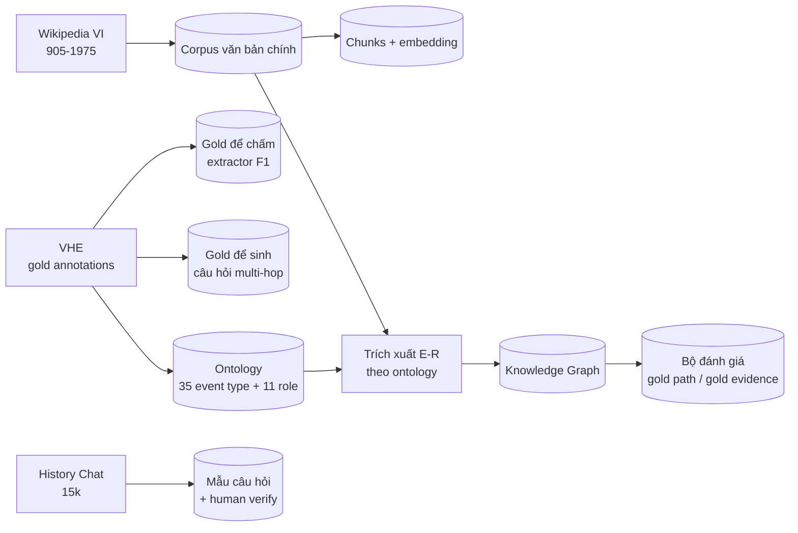

# 01 — Phân tích dữ liệu

> Mọi số liệu trong tài liệu này **đã đo thực tế** trên môi trường local (2026-11-01), không phải ước lượng.

## 1. Các nguồn dữ liệu khả dụng

### 1.1 VHE — Vietnamese Historical Events (PACLIC 2024)

`github.com/hoangthuytruc/vhe-dataset` — bộ dữ liệu trích xuất sự kiện lịch sử tiếng Việt, nguồn: *Đại Việt Sử Ký Toàn Thư*.

| File | Nội dung | Số đo thực tế |
|---|---|---|
| `event-extraction/event.json` | 4.111 câu, có event + argument đã gán nhãn | 5.181 event · 13.290 argument · 6.746 mention unique |
| `event-extraction/vhe_event_schema.json` | Schema 35 event type, 11 role | `be-born`, `attack`, `start-position`... |
| `event-extraction/role2id.json` | 11 role | temporal, location, agent, theme, beneficiary, instrument, source, goal, content, force, experiencer |
| `event-relation-extraction/event-relation.json` | 691 câu, có quan hệ giữa event | temporal 618 · causal 75 · subevent 58 |
| `event-relation-extraction/type2id.json` | Loại quan hệ | temporal: BEFORE/OVERLAP/CONTAINS/SIMULTANEOUS/ENDS-ON/BEGINS-ON; causal: CAUSE/PRECONDITION; subevent: SUBEVENT |

**Phân bố event type (top):** start-position 1.333 · die 891 · attack 844 · transport 380 · natural-phenomenon 266 · arrest-jail 248 · transfer-ownership 177 · end-position 123 · meet 119 · be-born 116.

**Phân bố role:** theme 4.120 · agent 3.738 · temporal 2.611 · goal 1.731 · location 645 · beneficiary 194 · source 125 · content 75 · instrument 35 · force 10 · experiencer 6.

#### Đánh giá: VHE dùng để làm gì, không dùng để làm gì

| Điểm mạnh | Điểm yếu (quyết định vai trò của VHE) |
|---|---|
| Schema event type + role có sẵn → làm **ontology cố định** cho trích xuất, đảm bảo KG đồng nhất giữa Wikipedia và VHE | Chỉ phủ **Hồng Bàng → Lê Trung hưng (≈ thế kỷ 16)**, không tới 1975 |
| Có quan hệ temporal/causal **có nhãn** → làm gold để sinh câu hỏi multi-hop **tự động kiểm chứng được** | Mention rất nhiễu: `vua` 416 lần, `mùa xuân` 195, `mùa thu` 175, `tháng giêng` 120, `quân` 51, `giặc` 73 → không dùng làm corpus để nhúng |
| Văn bản là **cổ Việt** (Hán-Việt, rất khác văn bản hiện đại) → tạo độ khó thật cho extractor | Chỉ 691 câu có quan hệ, quy mô nhỏ cho bài toán multi-hop |
| Nguồn **có citation rõ ràng** (đảm bảo tính xác thực lịch sử) | Có annotation bằng LLM → có nhiễu nhãn, paper báo cáo LLM hiện suất thấp trên VHE |

**Kết luận:** VHE là **nguồn schema + gold để chấm extractor + seed để sinh câu hỏi đánh giá**, không phải corpus chính.

### 1.2 Wikipedia tiếng Việt

Nguồn văn bản chính. Cơ chế: `vi.wikipedia.org/w/api.php` (MediaWiki API) — đã test kết nối OK.

- **Cách lấy**: danh sách bài seed theo triều đại/sự kiện → lấy nội dung + liên kết nội bộ → mở rộng đồ thị liên kết 1–2 vòng → lọc theo phạm vi 905–1975 và theo "lịch sử Việt Nam".
- **Ưu điểm**: bao phủ đủ tới 1975; có cấu trúc mục rõ ràng (chunk theo mục, không cắt cụt); có thể map sang Wikidata QID để đối chiếu tên thực thể.
- **Rủi ro**: bài viết có mục "Xem thêm", "Chú thích", "Tham khảo" cần lọc; tồn tại bài chuyên biệt về địa phương gây nhiễu → cần heuristic lọc theo độ dài + từ khóa thời kỳ.
- **Bổ sung**: dataset `undertheseanlp/UVW-2026` (1,12 triệu bài Wikipedia tiếng Việt + Wikidata QID + category) — dùng để lấy nhanh danh sách entity có QID thay vì crawl từng bài.

### 1.3 Vietnam History Chat (`minhxthanh/Vietnam-History-15k` / `-200k`)

ChatML, phủ 905–2025, format `system / user / assistant(analysis) / assistant(final)`. Đã xác nhận tồn tại và tải được.

- **Dùng cho**: (a) nguồn câu hỏi tham khảo để xây bộ đánh giá; (b) bổ sung text tri thức dạng hỏi đáp.
- **Cảnh báo**: tác giả ghi rõ "AI thu thập từ nguồn công khai nên có thể sai" → **không dùng làm nguồn kiểm chứng sự thật**, chỉ dùng làm mẫu câu hỏi và cần human-verify.
- **Bản 15k** đủ dùng cho bộ đánh giá; bản 200k/1M chỉ cần khi muốn lấy nhiều câu hỏi hơn.

### 1.4 Các bài báo liên quan (đã đọc, dùng để định vị đóng góp)

| Bài báo | Nội dung liên quan | Ảnh hưởng tới thiết kế |
|---|---|---|
| **HisGraphRAG** (PACLIC 2025) | GraphRAG cho MCQA lịch sử VN. 3 thành phần: entity alignment, temporal retrieval, answer-candidate filtering. Kết quả trên VUEE 2017/2018: LLM-only 68.3/50.8 → NaiveRAG 72.5/54.2 → GraphRAG 77.5/60.0 → HisGraphRAG 81.7/70.8. | Cho thấy 3 điểm yếu cần xử lý; nhưng chỉ đánh giá MCQA 4 lựa chọn → ta cần bộ câu hỏi tự do có gold path |
| **Tree-KG** (arxiv 2026) | KG dạng cây từ SGK THPT, 750 node / 4.341 edge, ontology 40→41 loại; Top-Down +4.7 NDCG@10 so với vector. | Cho thấy cấu trúc phân cấp (triều đại ⊃ sự kiện) là tín hiệu có giá trị → ta giữ node `Dynasty/Period` và quan hệ `BELONGED_TO_DYNASTY` |
| **VHE** (PACLIC 2024) | Bộ dữ liệu EE tiếng Việt | Ontology + gold đánh giá |
| **VN-MTEB** (2025) | Benchmark embedding tiếng Việt | Chọn model: Qwen3-Embedding-4B (52.70 NDCG@10) > bge-m3 (45.53) > multilingual-e5-large-instruct (35.86) |
| **ViRanker** (2025) | Cross-encoder reranker chuyên tiếng Việt | Ứng viên reranker domain lịch sử |

### 1.5 Môi trường thực thi (đã dò)

| Thành phần | Kết quả |
|---|---|
| Python | 3.12.3 (không có `pip` hệ thống → dùng **`uv`** có sẵn tại `~/.local/bin/uv`) |
| CPU / RAM | 8 vCPU (Intel i3-10105) / 23 GB |
| GPU | Không có GPU cục bộ |
| Docker | Engine 29.9.2 + Compose v5.1.4, daemon chạy tốt; đã pull thử `neo4j:5.26-community` và `qdrant/qdrant:v1.12.4` thành công |
| Port | 7474 / 7687 / 6333 đều trống |
| Network | pypi, github, huggingface, dockerhub đều truy cập được (cần `full_network` cho thao tác ngoài sandbox) |
| LLM | Gemini qua `google-genai` (free tier), key trong `.env` |

## 2. Quyết định chọn nguồn



**Vì sao không dùng VHE làm corpus chính**: (1) chỉ tới thế kỷ 16, không đáp ứng phạm vi tới 1975; (2) văn bản cổ Việt gần như không giaoiao với tiếng Việt hiện đại mà câu hỏi người dùng sử dụng → vector matching gần như vô hiệu; (3) mention nhiễu làm KG mất ý nghĩa.

**Vì sao vẫn giữ VHE**: schema có sẵn là "ontology chuẩn" để trích xuất từ Wikipedia với output đồng nhất, đồng thời cho ta một bộ gold đo được chất lượng extractor — một chỉ số định lượng đáng giá cho báo cáo.

## 3. Sơ đồ dữ liệu đầu ra

**`data/processed/corpus.jsonl`** — mỗi dòng một chunk:

```json
{
  "chunk_id": "wiki:Tran_Trung_Thang:sec3",
  "doc_id": "wiki:Tran_Trung_Thang",
  "title": "Trần Trung Thăng",
  "section": "Đời đời làm quan",
  "text": "Trần Trung Thăng (1042-1170) là một công thần ...",
  "url": "https://vi.wikipedia.org/wiki/Trần_Trung_Thăng",
  "wikidata_id": "Q1234567",
  "period": "tran",
  "year_min": 1042,
  "year_max": 1170,
  "source": "wikipedia"
}
```

**KG (Neo4j)** — xem chi tiết ở [`02_kien_truc.md`](02_kien_truc.md).

## 4. Rủi ro dữ liệu và cách xử lý

| Rủi ro | Mức | Xử lý |
|---|---|---|
| Crawler Wikipedia bị chặn / quá chậm | Trung bình | 1 req/giây + cache đĩa + `User-Agent` đúng; nếu cần thì dùng dump `viwiki-latest-pages-articles` |
| Văn bản wiki chứa nội dung phi lịch sử (bài kỹ thuật, địa phương) | Cao | Lọc theo `period` + từ khóa thời kỳ + độ dài; kiểm tra thủ công 20 bài mẫu ở cổng kiểm soát |
| Entity trùng lặp | Cao | Entity resolution 4 bước (mục 3.3 tài liệu 03) |
| Mention VHE quá chung chung (`vua`, `quân`) | Cao | Lọc bằng stoplist role-agnostic + yêu cầu mention có trường từ điển danh; không nhập các mention này làm node |
| Rò rỉ dữ liệu giữa bộ đánh giá và corpus | Trung bình | Tách theo **tài liệu**: 15% doc giữ lại làm `eval-exclusive`, không nạp vào KG |
| History Chat có lỗi sự thật | Trung bình | Chỉ dùng làm mẫu câu hỏi, human-verify trước khi vào bộ đánh giá |
| Câu hỏi người dùng nằm ngoài phạm vi KG | Cao | Thiết kế "từ chối trả lời khi không đủ căn cứ" → tính điểm cho hệ thống biết nói "không đủ thông tin" |
