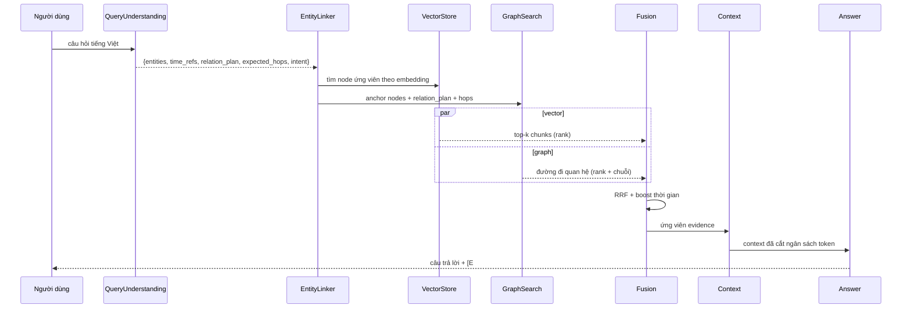
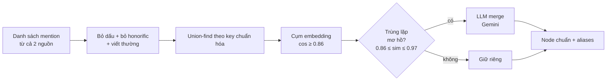

# 03 — Thuật toán truy xuất & sinh câu trả lời

## 1. Tổng quan pipeline truy vấn



## 2. Phân tích câu hỏi (Query Understanding)

Gemini, **JSON schema cứng**, output:

```json
{
  "intent": "multi_hop",
  "entities": ["Ngô Quyền", "Trần Hưng Đạo"],
  "time_refs": [938, 1288],
  "relation_plan": ["PRECEDED_BY", "PARTICIPATED_IN"],
  "expected_hops": 2,
  "answer_type": "event | person | place | year | cause | comparison | explanation",
  "needs_temporal_filter": true
}
```

- `intent` ∈ {`single_hop`, `multi_hop`, `temporal`, `comparison`, `out_of_scope`}.
- `expected_hops` quyết định độ sâu traversal (1–3), có cap cứng.
- **Quy tắc an toàn**: nếu `out_of_scope` (không liên quan lịch sử VN 905–1975) → trả "không thuộc phạm vi" mà không gọi LLM sinh đáp án.
- **Fallback không cần LLM**: regex năm (`\b(9|1[0-9])\d{2}\b`) và so khớp tên trong alias table → dùng khi Gemini lỗi/quota.

## 3. Entity Linking

Tầng chuẩn hoá (tên gọi trong `kg/alias.py`), từ rẻ → đắt, dừng sớm khi đủ tin cậy:

| Tầng | Cách làm | Điểm |
|---|---|---|
| **T0** | mention **là QID** (`Q123`) hoặc node đã biết trong KG | `1.00` |
| **T1** | alias Wikidata (`wbsearchentities`, altLabel) | `0.97` |
| **T2** | redirect Wikipedia (`tier 2`) | `0.93` |
| **T3** | redirect Wikipedia **xác minh bằng LLM** | `0.90` |
| **T4** | khớp `name_key` đã chuẩn hoá (bỏ dấu, bỏ honorific) | `0.85` |
| **T5** | embedding + LLM disambiguation (top-k ứng viên) | `0.60–0.90` |

- `kg/alias.py` chịu trách nhiệm **5 tầng QID-first** (ADR-07) và sinh *nhiều* ứng viên.
- `retrieval/entity_linker.py` là lớp vỏ của tầng QA: mỗi mention chỉ giữ **một anchor tốt nhất**, có ngưỡng cứng `entity_link_min_confidence = 0.7`; không khớp được thì trả danh sách **rỗng** (không bịa entity).
- Cờ ablation: `use_resolution=False` chỉ giữ **T0** → dùng cho ablation A1 (bỏ entity linking) và A2 (bỏ entity resolution).
- `entity_linker` còn trích xuất mention tiếng Việt bằng regex + danh sách stopword (`VIETNAMESE_STOPWORDS`) để pipeline vẫn chạy được khi bước Query Understanding không có kết quả.

> **Lưu ý thực tế**: bảng alias của hệ thống chạy chủ yếu ở **T0/T4** (node đã có trong KG + khớp tên đã chuẩn hoá); các tầng T1–T3 cần mạng và bị bỏ qua khi offline. Vì vậy ablation A1 cho thấy tác động của *tầng khớp mờ*, còn A2 cho thấy tác động của việc gộp node trùng.

## 4. Truy xuất vector

- Nhúng câu hỏi bằng embedder đang cấu hình (Gemini `gemini-embedding-2` 768 chiều, hoặc model **cục bộ** 384 chiều `paraphrase-multilingual-MiniLM-L12-v2` khi quota Gemini cạn).
- Hai collection Qdrant được tìm **song song** rồi gộp:
  - `chunks` (Wikipedia/LLM, 768 dim) và `chunks_vhe_local` (chú giải VHE, 384 dim) → nhúng câu hỏi vào **cả hai** collection tương ứng.
- `search` cosine với `limit = vector_top_k = 30`; payload filter tùy chọn `year ∈ [năm-20, năm+20]` khi câu hỏi có năm rõ ràng (bộ lọc được dịch sang `Filter(should=…)` của Qdrant 1.12).
- **Rerank**: `retrieval/rerank.py` có 2 backend:
  - `cross-encoder` (`BAAI/bge-reranker-v2-m3`) — chính xác hơn nhưng **~35 s/lần gọi trên CPU**;
  - `heuristic` — BM25 + boost thời gian + cosine similarity, chạy được trên CPU.
  - `rerank_backend: auto` (mặc định) **tự phát hiện CUDA**: có GPU → cross-encoder, không có → heuristic. Đây là lựa chọn bắt buộc cho lượt đánh giá 150 câu × 11 cấu hình trên máy CPU.
  - LLM-rerank (Gemini chọn top-k trong 1 lời gọi) là đường dự phòng khi cả hai backend trên không khả dụng.

## 5. Truy xuất đồ thị (phần lõi)

### 5.1 Truy vấn Cypher

```cypher
MATCH (a:Entity {uid: $uid})-[r]->(b:Entity)
RETURN a{.*} AS src, type(r) AS rel, properties(r) AS rprops, b{.*} AS dst
LIMIT 500
```

Traversal **có hướng** (`-[r]->-`) được thực hiện từng bước trong Python (`GraphSearcher._traverse`), không dùng `apoc.path.expandConfig` vì biến độ dài (`$maxHops`) không được Cypher cho phép. Mỗi bước:

1. lấy **hàng xuất** của node (giữ đúng hướng quan hệ — `neighbors()` không có hướng sẽ sinh ra các path sai như `A -CAUSE_OF-> B` khi thực tế là `B -CAUSE_OF-> A`);
2. giữ lại cạnh có `rel_type` nằm trong `relation_plan` (nếu có) — cạnh ngoài kế hoạch vẫn được phép nhưng bị chấm điểm thấp ở bước 5.2;
3. dừng ở `graph_max_hops = 3` (cap cứng), tối đa `graph_max_paths_per_hop = 30` path mỗi bước;
4. chống "hub": node có bậc quá cao bị loại khỏi việc mở rộng tiếp (`_degree_penalty`).

### 5.2 Chấm điểm đường đi

\[
S(\text{path}) = \underbrace{w_a \cdot \text{affinity}(\text{rel\_types}, \text{relation\_plan})}_{\text{đúng kế hoạch}} + \underbrace{w_s \cdot \text{sim}(q, \text{path\_text})}_{\text{ngữ nghĩa}} + \underbrace{w_t \cdot \text{temporal\_overlap}}_{\text{trùng thời gian}} - \underbrace{w_d \cdot \text{deg\_penalty}}_{\text{node độ bậc cao}}
\]

Trọng số nằm trong `PATH_SCORE_WEIGHTS` (`retrieval/graph_search.py`).

- `affinity`: mỗi cạnh được chấm `1.0` nếu `rel_type` có trong `relation_plan`; `0.9` nếu là quan hệ nhân quả/temporal mà câu hỏi có *cue* tương ứng ("vì sao", "trước/sau"); `0.5` khi câu hỏi trung tính; `0.0` nếu lệch kế hoạch. Lấy trung bình các cạnh.
- `sim`: cosine giữa embedding câu hỏi và embedding chuỗi mô tả path. **Tối ưu quota**: `_path_similarities` nhúng *tất cả* path trong **một** lệnh gọi embedding thay vì mỗi path một lệnh.
- `temporal_overlap`: có cạnh/năm trùng `year_refs` của câu hỏi.
- `deg_penalty`: chống node hub ("Nhà Lý" nối hàng trăm cạnh) làm nhiễu.

### 5.3 Đường đi được dùng làm evidence

Mỗi đường đi → 1 evidence với:
- `type = "graph_path"`
- `text` = mô tả tự nhiên của chuỗi triple (dùng cho LLM và để hiển thị)
- `provenance` = danh sách `chunk_id` của các cạnh `SUPPORTED_BY` + `edge_uids`

→ Đây là cơ chế **"chuỗi liên kết logic"** mà yêu cầu 3.4 nói tới.

## 6. Fusion (RRF) và ngân sách context

- **RRF**: \(score(d) = \sum_{list} \frac{1}{k + rank_{list}(d)}\), `k = rrf_k = 60`, giữa list `vector` và list `graph`. RRF chỉ cần *thứ hạng* nên hợp nhất được list cosine (vector) với list điểm path (graph) vốn khác thang đo.
- **Boost thời gian**: `+ temporal_boost = 0.15` nếu evidence chứa năm trùng câu hỏi (dùng `year_refs` của Query Understanding).
- **Ưu tiên đa dạng**: giới hạn ≤ `max_evidence_per_doc = 3` evidence từ cùng một `doc_id` → tránh 5 đoạn về cùng một bài (đây chính là "prompt bị nhiễu" gây giảm accuracy trong HisGraphRAG).
- **Ngân sách token**: `max_evidence = 12` evidence, tổng ≤ `context_max_tokens = 6000` → cắt theo điểm (thiếu ngân sách = ablation A6).
- Bỏ fusion (chỉ dùng vector top-k) = ablation A7.

## 7. Sinh câu trả lời

Prompt ràng buộc (tiếng Việt, `qa/answer.py::SYSTEM_PROMPT`):

```
Bạn là chuyên gia lịch sử Việt Nam, trả lời câu hỏi dựa TRÊN DUY NHẤT ngữ cảnh được cung cấp.
1. Chỉ sử dụng thông tin có trong CONTEXT. TUYỆT ĐỐI không bịa thông tin ngoài CONTEXT.
2. Sau mỗi mệnh đề khẳng định phải gắn nguồn trích dẫn dạng [E1], [E2]... trúng với số hiệu evidence.
3. Nếu CONTEXT không đủ để trả lời, hãy trả lời đúng câu:
   "Tôi không tìm thấy đủ thông tin trong kho kiến thức để trả lời câu hỏi này." và KHÔNG suy đoán.
4. Trả lời bằng tiếng Việt, súc tích, đúng mốc thời gian và địa danh.
5. Kết thúc bằng một mục "## Suy luận" gồm các bước suy luận đánh số (1., 2., 3.), mỗi bước có trích dẫn.
```

**Post-processing (quan trọng cho điểm "có căn cứ")**:
1. `validate_citations()` tách citation **hợp lệ** (có `E#` trong evidence) và **sai** (không tồn tại) → loại bỏ citation sai.
2. `refused` được suy ra bằng `is_refusal()` (so khớp các cụm từ từ chối đặc hiệu) — nếu **không còn citation nào** → coi là câu trả lời không có căn cứ, đánh dấu `grounded=False` trong error analysis.
3. `parse_reasoning_chain()` lấy phần sau tiêu đề `## Suy luận` (hoặc `## Reasoning`/`## Lập luận`/`## Chain of thought`), tách từng bước đánh số; nếu mô hình không dùng tiêu đề thì lấy các dòng bắt đầu bằng `1.`/`-`/`*`.
4. Trả về kèm `used_evidence` (đã lọc theo citation thực sự dùng) và `subgraph` (node/edge được dùng) để UI vẽ.

**Baseline B0 (closed-book)** dùng prompt riêng (`CLOSED_BOOK_SYSTEM_PROMPT`): không CONTEXT, không citation, trả lời bằng kiến thức tham số của mô hình → đây là baseline "LLM-only" mà docs/04 §4.1 yêu cầu.

**Sinh chuỗi suy luận** cho multi-hop: phần `## Suy luận` do mô hình sinh **kèm citation** từ evidence đã cung cấp (chính là các `graph_path` evidence) → đảm bảo "chuỗi liên kết logic" có nguồn thật, không phải LLM tự bịa.

## 8. Entity Resolution (offline)



- Node chuẩn giữ `aliases` (mọi biến thể) → entity linking tầng 1 khớp được nhiều cách viết.
- **Chống merge sai**: chỉ merge khi LLM xác nhận; ngoài ngưỡng → giữ riêng, ghi vào báo cáo (minh bạch).
- Mỗi node có `wikidata_id` nếu khớp được → dùng để đối chiếu thủ công khi kiểm tra.

## 9. Xử lý câu hỏi ngoài phạm vi & không đủ căn cứ

| Tình huống | Hành vi |
|---|---|
| Không liên quan lịch sử VN 905–1975 | Trả "Ngoài phạm vi" — tính đúng (không bịa) |
| Liên quan nhưng KG không đủ thông tin | Trả "Tài liệu hiện có không đủ thông tin" |
| Có đáp án nhưng thiếu căn cứ truy vết | Đánh dấu `grounded=False`, vẫn hiển thị để phân tích lỗi |

Bộ đánh giá có **20 câu out-of-KB** để đo hành vi này — đây là điểm mà baseline RAG thuần hay "bịa" và GraphRAG có lợi thế.

## 10. Ví dụ minh hoạ

**Câu hỏi:** "Vì sao nhà Trần phải gả Hoàng thái chúa Trần Khánh Dư cho vua Đinh?"

| Bước | Thành phần | Kết quả |
|---|---|---|
| 1 | Query Understanding | intent=`multi_hop`, entities=[Trần Khánh Dư, Đinh Bộ Lĩnh], time_refs=[1000], expected_hops=2, relation_plan=[`PRECEDED_BY`, `ABOUT`] |
| 2 | Entity Linking | `Trần Khánh Dư` → `:Person` (confidence 0.95), `Đinh Bộ Lĩnh` → `:Person` (0.93) |
| 3 | Vector | top chunk từ bài "Trần Khánh Dư" (đoạn nói về hôn ước) |
| 4 | Graph | path: `Trần Khánh Dư -[PRECEDED_BY]-> Hôn ước 1000 -[ABOUT]-> Đinh Bộ Lĩnh` + path đệ tử Nguyễn Trung Ngạn |
| 5 | Fusion | 3 evidence: 2 chunk + 1 graph_path |
| 6 | Sinh | "Vì nguy cơ cung đình Đinh Bộ Lĩnh bị phế, nhà Trần gả Trần Khánh Dư (con Trần Trọng Tháp) cho Đinh Bộ Lĩnh [E1][E3]. Việc này tạo mối quan hệ hôn nhân giữa hai nhà, làm suy yếu quyền lực riêng của Nguyễn Trung Ngạn [E3]." |
| 7 | Giải thích | Subgraph 5 node / 5 edge hiển thị trên UI |

*(Số liệu trên là ví dụ minh hoạ, chưa phải kết quả chạy thật.)*
