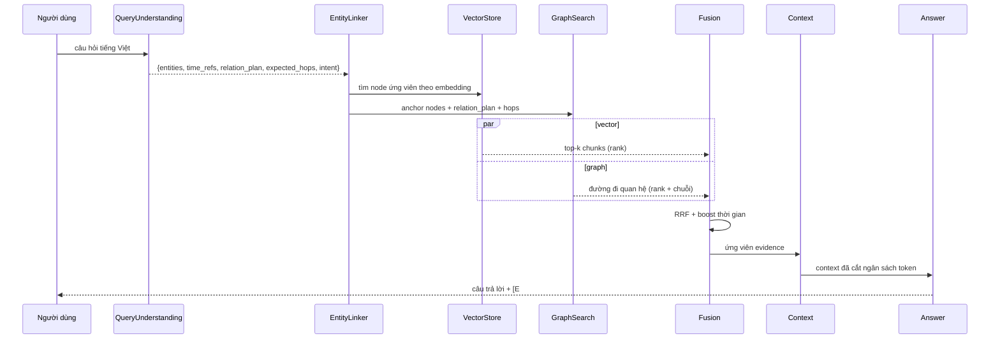
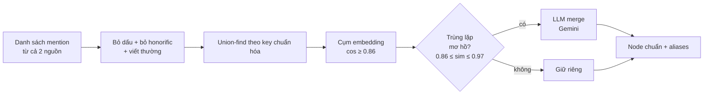

# 03 — Thuật toán truy xuất & sinh câu trả lời

## 1. Tổng quan pipeline truy vấn



## 2. Phân tích câu hỏi (Query Understanding)

Gemini, **JSON schema cứng**, output:

```json
{
  "intent": "multi_hop",
  "entities": ["Ngô Quyền", "Trần Hưng Đạo"],
  "time_refs": [938, 1288],
  "relation_plan": ["PRECEDED_BY", "PARTICIPATED_IN"],
  "expected_hops": 2,
  "answer_type": "event | person | place | year | cause | comparison | explanation",
  "needs_temporal_filter": true
}
```

- `intent` ∈ {`single_hop`, `multi_hop`, `temporal`, `comparison`, `out_of_scope`}.
- `expected_hops` quyết định độ sâu traversal (1–3), có cap cứng.
- **Quy tắc an toàn**: nếu `out_of_scope` (không liên quan lịch sử VN 905–1975) → trả "không thuộc phạm vi" mà không gọi LLM sinh đáp án.
- **Fallback không cần LLM**: regex năm (`\b(9|1[0-9])\d{2}\b`) và so khớp tên trong alias table → dùng khi Gemini lỗi/quota.

## 3. Entity Linking

Ba tầng, từ rẻ → đắt, dừng sớm khi đủ tin cậy:

| Tầng | Cách làm | Ngưỡng |
|---|---|---|
| 1. Chính xác | khớp `normalized key` trong alias table (đã bỏ dấu, bỏ honorific) | chuẩn hóa khớp → `confidence = 0.95` |
| 2. Gần đúng | cosine embedding giữa chuỗi trong câu hỏi và mô tả node | `≥ 0.86` → `confidence = score` |
| 3. LLM | đưa top-5 ứng viên cho Gemini chọn + phân giải lịch sử (ví dụ "Trường học" = "Quốc Tự Giám"?) | `confidence = 0.9` |

Trả về **anchor node** + `confidence`; node có `confidence < 0.7` thì chỉ dùng làm gợi ý vector, **không** dùng làm điểm xuất phát traversal (tránh lan sai).

## 4. Truy xuất vector

- Nhúng câu hỏi (chi tiết câu hỏi → `question`; câu hỏi → `question` + `relation_plan` làm truy vấn mở rộng → 2 vector, lấy max score).
- Qdrant `search` trên collection `chunks` (cosine) với `limit = 30`.
- **Rerank**: cross-encoder `bge-reranker-v2-m3` (từ Kaggle) hoặc `ViRanker` → top-10. Fallback: LLM-rerank (Gemini chọn top-k trong 1 lời gọi).
- Payload filter tùy chọn: `year ∈ [năm-20, năm+20]` khi câu hỏi có năm rõ ràng.

## 5. Truy xuất đồ thị (phần lõi)

### 5.1 Truy vấn Cypher

```cypher
MATCH path = (a)-[r*1..$maxHops]->(b)
WHERE a.uid IN $anchorUids
  AND all(rel IN relationships(path) WHERE rel.type IN $allowedTypes)
  AND any(n IN nodes(path) WHERE n.year BETWEEN $yearMin AND $yearMax)
RETURN path, [rel IN relationships(path) | rel.text] AS edge_texts
LIMIT $maxPaths
```

Dùng `apoc.path.expandConfig` để giới hạn độ sâu và số kết quả thay vì biến độ dài (`$maxHops` là biến → cần dùng `apoc.path.expandConfig` hoặc 3 truy vấn riêng cho depth 1/2/3).

### 5.2 Chấm điểm đường đi

\[
S(\text{path}) = \underbrace{\alpha \cdot \text{sim}(q, \text{concat}(\text{edge\_texts}))}_{\text{ngữ nghĩa}} + \underbrace{\beta \cdot \text{affinity}(\text{rel\_types}, \text{relation\_plan})}_{\text{đúng kế hoạch}} + \underbrace{\gamma \cdot \text{temporal\_overlap}}_{\text{trùng thời gian}} - \underbrace{\delta \cdot \text{deg\_penalty}}_{\text{node độ bậc cao}} + \underbrace{\epsilon \cdot \text{path\_bonus}}_{\text{đúng loại quan hệ}}
\]

- `sim` dùng embedding của chuỗi mô tả đường đi (precomputed khi build KG).
- `affinity` = trung bình trong các cạnh của `cosine(embedding(rel_type), embedding(relation_plan_item))` → ưu tiên đường đi đi đúng quan hệ cần tìm.
- `temporal_overlap` = 1 nếu có cạnh `HAPPENED_AT` trùng năm trong câu hỏi.
- `deg_penalty` chống "hub" (node như "Nhà Lý" nối hàng trăm cạnh) làm nhiễu.

### 5.3 Đường đi được dùng làm evidence

Mỗi đường đi → 1 evidence với:
- `type = "graph_path"`
- `text` = mô tả tự nhiên của chuỗi triple (dùng cho LLM và để hiển thị)
- `provenance` = danh sách `chunk_id` của các cạnh `SUPPORTED_BY` + `edge_uids`

→ Đây là cơ chế **"chuỗi liên kết logic"** mà yêu cầu 3.4 nói tới.

## 6. Fusion (RRF) và ngân sách context

- **RRF**: \(score(d) = \sum_{list} \frac{1}{k + rank_{list}(d)}\), `k = 60`, giữa list `vector` và list `graph`.
- **Boost thời gian**: `+ w_t` nếu evidence chứa năm trùng câu hỏi.
- **Ưu tiên đa dạng**: giới hạn ≤ 3 evidence từ cùng một `doc_id` để tránh 5 đoạn về cùng một bài → giảm nhiễu (đây chính là "prompt bị nhiễu" gây giảm accuracy trong HisGraphRAG).
- **Ngân sách token**: `top_k` evidence, tổng ≤ `max_context_tokens` (mặc định 6.000) → cắt theo điểm.

## 7. Sinh câu trả lời

Prompt ràng buộc (tiếng Việt):

```
Bạn là trợ lý lịch sử Việt Nam. Chỉ được dùng THÔNG TIN trong CONTEXT.
Mỗi mệnh đề phải kèm citation [E1], [E2]...
Nếu CONTEXT không đủ để trả lời, trả: "Tài liệu hiện có không đủ thông tin để trả lời câu hỏi này."
Với câu hỏi multi-hop, trước khi trả lời phải nêu "Chuỗi suy luận:" gồm từng bước kèm citation.
```

**Post-processing (quan trọng cho điểm "có căn cứ")**:
1. Kiểm tra mọi `[E#]` có tồn tại trong evidence → loại bỏ citation sai.
2. Nếu **không còn citation nào** → coi là câu trả lời không có căn cứ → đánh dấu `grounded=False`, ghi nhận vào error analysis.
3. Trả về kèm `used_evidence` (đã lọc theo citation thực sự dùng) và `subgraph` (node/edge được dùng) để UI vẽ.

**Sinh chuỗi suy luận** cho multi-hop: lấy trực tiếp từ `graph_path` evidence đã dùng → đảm bảo "chuỗi liên kết logic" có nguồn thật, không phải LLM tự bịa.

## 8. Entity Resolution (offline)



- Node chuẩn giữ `aliases` (mọi biến thể) → entity linking tầng 1 khớp được nhiều cách viết.
- **Chống merge sai**: chỉ merge khi LLM xác nhận; ngoài ngưỡng → giữ riêng, ghi vào báo cáo (minh bạch).
- Mỗi node có `wikidata_id` nếu khớp được → dùng để đối chiếu thủ công khi kiểm tra.

## 9. Xử lý câu hỏi ngoài phạm vi & không đủ căn cứ

| Tình huống | Hành vi |
|---|---|
| Không liên quan lịch sử VN 905–1975 | Trả "Ngoài phạm vi" — tính đúng (không bịa) |
| Liên quan nhưng KG không đủ thông tin | Trả "Tài liệu hiện có không đủ thông tin" |
| Có đáp án nhưng thiếu căn cứ truy vết | Đánh dấu `grounded=False`, vẫn hiển thị để phân tích lỗi |

Bộ đánh giá có **20 câu out-of-KB** để đo hành vi này — đây là điểm mà baseline RAG thuần hay "bịa" và GraphRAG có lợi thế.

## 10. Ví dụ minh hoạ

**Câu hỏi:** "Vì sao nhà Trần phải gả Hoàng thái chúa Trần Khánh Dư cho vua Đinh?"

| Bước | Thành phần | Kết quả |
|---|---|---|
| 1 | Query Understanding | intent=`multi_hop`, entities=[Trần Khánh Dư, Đinh Bộ Lĩnh], time_refs=[1000], expected_hops=2, relation_plan=[`PRECEDED_BY`, `ABOUT`] |
| 2 | Entity Linking | `Trần Khánh Dư` → `:Person` (confidence 0.95), `Đinh Bộ Lĩnh` → `:Person` (0.93) |
| 3 | Vector | top chunk từ bài "Trần Khánh Dư" (đoạn nói về hôn ước) |
| 4 | Graph | path: `Trần Khánh Dư -[PRECEDED_BY]-> Hôn ước 1000 -[ABOUT]-> Đinh Bộ Lĩnh` + path đệ tử Nguyễn Trung Ngạn |
| 5 | Fusion | 3 evidence: 2 chunk + 1 graph_path |
| 6 | Sinh | "Vì nguy cơ cung đình Đinh Bộ Lĩnh bị phế, nhà Trần gả Trần Khánh Dư (con Trần Trọng Tháp) cho Đinh Bộ Lĩnh [E1][E3]. Việc này tạo mối quan hệ hôn nhân giữa hai nhà, làm suy yếu quyền lực riêng của Nguyễn Trung Ngạn [E3]." |
| 7 | Giải thích | Subgraph 5 node / 5 edge hiển thị trên UI |

*(Số liệu trên là ví dụ minh hoạ, chưa phải kết quả chạy thật.)*
