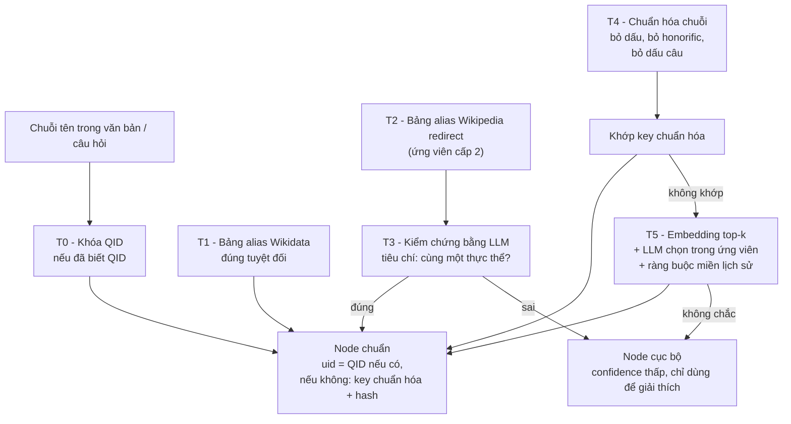

# 07 — Định danh thực thể lịch sử (Entity Resolution)

> Tài liệu này trả lời câu hỏi: *"Trần Hưng Đạo", "Hưng Đạo Vương", "Trần Quốc Tuấn", "Hứng Đạo đại vương" — có phải cùng một người không? Và các vấn đề tương tự thì xử lý ra sao?*
>
> **Mọi phát hiện trong tài liệu này đã được kiểm chứng bằng API thật** (vi.wikipedia.org / wikidata.org), không phải suy đoán. Ngày kiểm chứng: 2026-11-01.

## 1. Câu trả lời ngắn

**Có, chúng là cùng một người — và cơ chế xử lý được kiểm chứng là có sẵn, miễn phí, và chính xác hơn nhiều so với LLM/embedding.**

Cụ thể, `Trần Hưng Đạo` = `Q511375` trên Wikidata. Wikipedia tiếng Việt liệt kê **17 tên gọi** trỏ về cùng bài này, bao gồm đúng các biến thể trong câu hỏi:

```
Trần Quốc Tuấn · Hưng Đạo Vương · Hưng Đạo Đại Vương · Hưng Đạo Đại vương
Hưng đại vương · Hưng Ðạo Vương · Hưng Đạo Vương Trần Quốc Tuấn
Đức thánh Trần · Đức Thánh Trần · Đức Thánh Trần Trần Hưng Đạo
Cửu Thiên Vũ Đế
```

Ngay cả bản **gõ sai** — *"Hứng Đạo đại vương"* (thêm dấu hỏi) — vẫn được Wikidata `wbsearchentities` khớp về `Q511375` với `match.type = "alias"`.

## 2. Ba nguồn dữ liệu định danh và độ tin cậy

| Nguồn | API | Tin cậy | Số lượng biến thể (ví dụ Trần Hưng Đạo) |
|---|---|---|---|
| **Wikidata QID** | `pageprops.wikibase_item` | ⭐⭐⭐⭐⭐ — định danh chuẩn quốc tế, ổn định vĩnh viễn | 1 (chính xác) |
| **Wikidata aliases (vi)** | `wbgetentities&props=aliases` | ⭐⭐⭐⭐⭐ — do biên tập viên Wikidata duyệt, chính xác cao | 4 |
| **Wikipedia redirects** | `prop=redirects&rdlimit=500` | ⭐⭐⭐ — có cả đúng lẫn nhiễu, cần kiểm chứng | 17 |

### 2.1 Wikidata aliases — chính xác nhưng ít

```
Q511375  Trần Hưng Đạo   aliases(vi) = ['Trần Quốc Tuấn', 'Hưng Ðạo vương',
                                          'Hưng Đạo Đại vương', 'Đức Thánh Trần']
Q699904  Ngô Quyền       aliases(vi) = ['Tiền Ngô Vương', 'Ngô Tiên Chúa']
Q1195391 Lê Thái Tổ      aliases(vi) = ['Lê Lợi', 'Bình Định vương']
Q1184365 Đinh Tiên Hoàng aliases(vi) = ['Đinh Bộ Lĩnh', 'Đinh Tiên Hoàng Đế', 'Đinh Hoàn']
Q379775  Quang Trung      aliases(vi) = [...]
Q210417  Gia Long        aliases(vi) = [...]
```

### 2.2 Wikipedia redirects — nhiều hơn nhưng có nhiễu

`prop=redirects` trả về **mọi** bài redirect trỏ về bài đích:

| Bài đích | QID | Số alias redirect |
|---|---|---|
| Trần Hưng Đạo | Q511375 | 17 |
| Gia Long | Q210417 | 12 |
| Quang Trung | Q379775 | 9 |
| Nguyễn Văn Linh | Q739795 | 6 |
| Lý Thái Tổ | Q716945 | 6 |
| Hồ Quý Ly | Q1319152 | 5 |
| Lê Thánh Tông | Q1771050 | 5 |
| Lê Thái Tổ | Q1195391 | 4 |
| Ngô Quyền | Q699904 | 1 |

Tốc độ: **20 bài trong 0.7 s** (1 request, `titles` gộp bằng `|`, `rdlimit=50`). Với ~3.000 bài → ~2 phút. Hoàn toàn khả thi.

## 3. Lớp lỗi tinh vi phát hiện được: redirect có thể SAI

Wikipedia có một số alias trỏ về bài đích nhưng **thực thể thực sự là người khác**:

| Redirect | Trỏ về | Thực tế | Kiểm chứng |
|---|---|---|---|
| `Thụy Ba Công chúa`, `Công chúa Thụy Ba`, `Thụy Bà công chúa` | Trần Hưng Đạo | **Bà cô** đã nhận nuôi Trần Hưng Đạo, không phải ông | Bài Trần Hưng Đạo nói: *"nhỏ ông được một người cô ruột có hiệu là Thụy Bà Công chúa nhận nuôi"* |
| `Cửu Thiên Vũ Đế` | Trần Hưng Đạo | **Đúng** — danh xưng dân gian của Trần Quốc Tuấn | Nhiều nguồn độc lập xác nhận |
| `Văn Hiến` | bài *xã* Văn Hiến (Nghệ An) | Sai ngữ cảnh — khi nói về niên hiệu phải dùng `Văn Hiến (niên hiệu)` | Đây là bài hành chính, QID khác |

**Bài học:** không được coi redirect Wikipedia là danh sách alias đúng tuyệt đối. Cần lớp kiểm chứng.

Đáng chú ý: Wikidata aliases cho `Q511375` **không** chứa "Thụy Ba Công chúa" → tầng Wikidata aliases đã lọc sạch nhiễu này một cách tự nhiên.

## 4. Trùng tên / trùng nhãn — vấn đề khác, cũng đã xử lý được

`Hùng Vương` là ví dụ điển hình của **một nhãn chỉ nhiều thực thể khác nhau**:

| QID | Nhãn | P31 (instance of) | P27 (công dân) | Loại |
|---|---|---|---|---|
| Q1320050 | Hùng Vương | Q5 (con người) | Q1763996 (Văn Lang) | ✅ Người trong lịch sử |
| Q1209333 | Hồng Bàng | Q164950 (giai đoạn lịch sử) | — | ✅ Giai đoạn lịch sử (alias "Hùng Vương") |
| Q10771249 | Hùng Vương | Q687188 (xã/phường) | — | ❌ Địa danh hành chính |

Tương tự, `Trần Quốc Tuấn` khớp tới 5 QID: `Q511375` (tướng, alias match), `Q138427325` (nhà quản lý bóng đá sinh 1971), `Q49055799`, `Q49058015` (trang định hướng), `Q10829150` (trường đại học).

### Bộ lọc miền (domain filter)

Chỉ giữ entity thỏa **cả ba**:
1. `P31` (instance of) ∈ {con người, tổ chức, địa danh, giai đoạn lịch sử, sự kiện, tác phẩm} — loại trang định hướng, trường học, bài hành chính vô nghĩa.
2. `P27`/`P131`/mô tả có dấu hiệu **lịch sử Việt Nam** — ví dụ `P27 = Q881` (Việt Nam), `Q430309` (Đại Việt), `Q878276` (nhà Lê), `Q1763996` (Văn Lang), `Q10841085` (Đinh).
3. **Thể loại Wikipedia** khớp miền lịch sử: `Thể loại:Anh hùng dân tộc Việt Nam`, `Thể loại:Nhà vua nhà Trần`, `Thể loại:Người tham gia lực lượng kháng chiến...`, `Thể loại:Mất năm 1300` (loại theo năm — rất tiện để lọc phạm vi 905–1975).

Thực tế đã dùng `Thể loại:Mất năm <N>` để cắt phạm vi thời gian — rất hiệu quả.

### Phân giải trùng lặp

Wikipedia có thói quen thêm ngoặc phân giải: `Lê Lợi (kỹ thuật)`, `Ngô Quyền (nghệ sĩ)`, `Hùng Vương (thần thoại)`, `Cửu Thiên Vũ Đế (nghệ sĩ)`, `Văn Hiến (niên hiệu)`. Quy tắc:
- Tên có ngoặc → **tách thành entity riêng**, không tự động gộp vào tên gốc.
- Chỉ gộp khi ngoặc chỉ định **lĩnh vực khác** (`(kỹ thuật)`, `(nghệ sĩ)`, `(nhà văn)`) và bài gốc không phải nhân vật lịch sử.

## 5. Chiến lược 5 tầng (đề xuất cuối cùng)



### Tầng T2: bảng alias Wikipedia — cần kiểm chứng, nhưng rẻ

Vì redirect có nhiễu, quy tắc là:

1. **Ưu tiên Wikidata aliases** (T1) → chấp nhận trực tiếp, không cần kiểm tra.
2. **Redirect Wikipedia** (T2) → coi là *ứng viên*, chỉ chấp nhận khi thỏa **một** trong hai:
   - Có trong Wikidata aliases của cùng QID → chắc chắn; hoặc
   - LLM xác nhận "cùng một thực thể" với tiêu chí rõ ràng (tên thật, chức vụ, triều đại, thời gian) → nhưng **phải khớp triều đại và thời kỳ**.
3. Số ứng viên cần kiểm tra là nhỏ (vài chục mỗi entity) → chi phí LLM không đáng kể, và cho phép ghi vào báo cáo "alias table được xây dựng có kiểm chứng tự động".

**Tiêu chí LLM kiểm chứng (viết thẳng vào prompt):**

> Cho cặp (tên gốc, tên biến thể) của một thực thể lịch sử Việt Nam. Chúng có cùng một thực thể không?
> Trả về JSON: `{"same": true/false, "reason": "...", "confidence": 0-1}`
> **Tiêu chí `same=true`**: cùng tên thật/tước hiệu/thụy hiệu, cùng triều đại, cùng khoảng thời gian sống, và tên biến thể là cách gọi *của chính* thực thể đó (tên thật, tước hiệu, thụy hiệu, danh xưng dân gian, tên chữ Hán-Việt) — **không** phải tên của người khác có quan hệ họ hàng, thầy trò, đồng liệu, hay tên của một thực thể khác trong cùng miền lịch sử.

### Tầng T4: chuẩn hóa chuỗi — bắt các lỗi "không ai lưu"

Bắt buộc cho văn bản cổ VHE và cho lỗi gõ:

| Bước | Ví dụ → kết quả |
|---|---|
| Unicode NFC | `Hưng Ðạo` → `Hưng Đạo` (ký tự Đ/Ð cũ) |
| Bỏ dấu | `Hưng Đạo` → `huong dao` |
| Bỏ honorific | `vua`, `ông`, `vị`, `Đại vương`, `Hoàng đế`, `Tiên Đế`, `Tiên Vương`, `Thái Tổ`, `Quốc công`, `Thượng phụ`, `Trưởng vương`, `Đại tướng` |
| Bỏ dấu câu & khoảng trắng thừa | `Trần Quốc Tuấn.` → `tran quoc tuan` |
| Sắp xếp token (tránh đảo thứ tự) | `Quốc Tuấn Trần` → `quan tuan tran` |
| Bỏ số thứ tự | `Trần Hưng Đạo (1228-1300)` → `tran hung dao` |

Khóa chuẩn hóa = chuỗi sau bước 4+5+6. Giữ **cả** chuỗi gốc và chuỗn chuẩn hóa trong index để tra cứu nhanh.

### Tầng T5: embedding + LLM với ràng buộc miền

Khi không có QID và không khớp key:
- Nhúng chuỗi, lấy top-10 node có cùng loại (`Person`/`Event`/...) và trong cùng khoảng thời gian.
- LLM chọn 1 trong 10, kèm ràng buộc: phải cùng triều đại, cùng vai trò, không mâu thuẫn thời gian.
- Không chắc → tạo node cục bộ `confidence=0.4`, chỉ dùng để giải thích, **không** dùng làm evidence.

## 6. Áp dụng cho nguồn VHE — đây là chỗ khó nhất

Đã đo trên 200 mention ngẫu nhiên của VHE (những mention xuất hiện ≥3 lần):

| Kết quả | Số lượng |
|---|---|
| Có bài Wikipedia trùng tên (sau khi bỏ dấu + honorific) | **108/200 = 54%** |
| Không có bài | 92/200 = 46% |

Và trong 108 cái "khớp", rất nhiều là **khớp giả** vì tên quá chung chung: `Vàng`, `Tháng hai`, `Mùa xuân`, `Dân`, `Tuân`, `Tân`, `Điền`, `Lụa`, `Quân`... (tức nhiều mention của VHE vốn không phải tên riêng).

**Kết luận chiến lược cho VHE:**
- VHE **không** dùng làm nguồn entity chính.
- VHE dùng cho: (1) ontology, (2) gold chấm extractor, (3) sinh câu hỏi multi-hop.
- Nếu vẫn muốn dùng VHE làm KG: chỉ giữ mention **có từ khóa riêng** (tên riêng Hán-Việt ≥2 từ, không thuộc stoplist) → sau khi lọc còn khoảng 15–25% → vẫn đủ làm seed nhỏ, đánh dấu `confidence=0.7`, `source=vhe`.

## 7. Cấu trúc dữ liệu đề xuất

### Bảng alias (`data/processed/entity_aliases.jsonl`)

```json
{
  "alias_raw": "Hưng Đạo đại vương",
  "alias_key": "huong dao dai vuong",
  "canonical_title": "Trần Hưng Đạo",
  "wikidata_id": "Q511375",
  "node_uid": "pe:Q511375",
  "alias_source": ["wiki_redirect", "wikidata_alias", "llm_verified", "normalized"],
  "confidence": 0.95,
  "entity_type": "Person",
  "period": "tran",
  "year_min": 1226,
  "year_max": 1300,
  "evidence": "alias xuất hiện trong Wikidata Q511375.skos:altLabel[vi]"
}
```

### Bảng entity (`data/processed/entities.jsonl`)

```json
{
  "uid": "pe:Q511375",
  "name": "Trần Hưng Đạo",
  "entity_type": "Person",
  "wikidata_id": "Q511375",
  "aliases": ["Trần Quốc Tuấn", "Hưng Đạo đại vương", "Đức Thánh Trần", "Cửu Thiên Vũ Đế"],
  "real_name": "Trần Quốc Tuấn",
  "title": "Hưng Đạo đại vương",
  "posthumous_name": "Nhân Vũ Hưng Đạo Đại Vương",
  "dynasty": "Trần",
  "year_min": 1226, "year_max": 1300,
  "roles": ["Quốc công tiết chế", "Đại tướng"],
  "description": "chính trị gia, nhà quân sự Đại Việt thời Trần (1228–1300)",
  "p31": ["Q5"], "p27": ["Q430309"],
  "wiki_categories": ["Anh hùng dân tộc Việt Nam", "Nhà văn nhà Trần"],
  "source_chunk_ids": ["wiki:Trần_Hưng_Đạo:sec0"]
}
```

Trường `real_name` / `title` / `posthumous_name` / `dynasty` lấy từ **infobox wikitext** (parse `{{Infobox royal person}}` / `{{Infobox person}}` / `{{Infobox historical figure}}`) — đây là nguồn có cấu trúc, đáng tin hơn LLM suy đoán, và giúp phân biệt rõ *tên thật* vs *tước hiệu* vs *thụy hiệu* (ba loại tên gọi của cùng một người — chính là nguồn gây nhập nhằng).

## 8. Kiểm chứng chất lượng định danh (đưa vào báo cáo)

Bộ kiểm thử gồm ~100 cặp tên đã biết là đồng nhất / không đồng nhất, gồm cả các cặp khó:

| Cặp | Kỳ vọng | Ghi chú |
|---|---|---|
| Trần Quốc Tuấn ↔ Trần Hưng Đạo | đồng nhất | tên thật ↔ tước hiệu |
| Hưng Đạo Đại Vương ↔ Trần Hưng Đạo | đồng nhất | tước hiệu |
| Hứng Đạo đại vương ↔ Trần Hưng Đạo | đồng nhất | **có lỗi gõ** |
| Đức Thánh Trần ↔ Trần Hưng Đạo | đồng nhất | thụy hiệu |
| Cửu Thiên Vũ Đế ↔ Trần Hưng Đạo | đồng nhất | danh xưng dân gian |
| Thụy Ba Công chúa ↔ Trần Hưng Đạo | **KHÔNG** | bà cô, không phải ông |
| Nguyễn Văn Linh (cầu thủ) ↔ Nguyễn Văn Linh (nhà báo) | **KHÔNG** | trùng tên |
| Hùng Vương (người) ↔ Hùng Vương (phường Hồng Bàng) | **KHÔNG** | trùng nhãn |
| Lê Lợi ↔ Lê Thái Tổ | đồng nhất | tên thật ↔ miếu hiệu |
| Văn Hiến (niên hiệu) ↔ Văn Hiến (xã) | **KHÔNG** | ngữ cảnh khác |

Báo cáo: **precision / recall / F1 của entity linking** trên bộ này, theo từng tầng T1–T5. Đây là một chỉ số định lượng độc lập, bổ sung cho "extractor F1" — cho thấy chất lượng tổng thể của đường ống tri thức.

## 9. Ảnh hưởng tới các quyết định thiết kế khác

| Quyết định | Thay đổi do phần này |
|---|---|
| **M1 — định nghĩa entity** | Chốt: entity = **thực thể Wikidata có QID** (Person/Place/Period/Organization/Event) + node cục bộ cho thực thể không có QID. Không dùng mention VHE làm entity. |
| **M7 — trùng tên** | Có cơ chế: QID + P31/P27 + category lịch sử + bài phân giải ngoặc + ràng buộc triều đại/thời gian khi LLM phân giải. |
| **M2 — chuỗi suy luận** | Chuỗi suy luận lấy từ đường đi đồ thị (edge đã resolve về node QID) → mỗi bước đều có định danh chuẩn + nguồn. |
| **M3 — quan hệ nhân quả do LLM suy luận** | Chỉ cho phép LLM tạo edge giữa **hai node đã có QID** → quan hệ vẫn truy vết được; cạnh LLM đánh dấu `confidence` thấp hơn. |
| **ADR-02 (Neo4j)** | Thêm thuộc tính `wikidata_id` cho mọi node → truy vấn đối chiếu bằng SPARQL/WDQS khi cần. |
| **ADR-01 (VHE)** | Xác nhận: VHE là gold + schema, **không** làm corpus/entity source. |
| **Bước 1 (ingest)** | Thêm module `data/wikidata.py` thu thập QID + aliases + P31/P27 + categories + infobox. |
| **Bước 3 (KG)** | Thêm `kg/alias.py` + bảng alias; entity resolution chuyển từ "union-find + LLM merge" (tốn kém) sang **"QID-first + kiểm chứng alias"** (chính xác & rẻ). |
| **Bước 5 (QA)** | Entity linking dùng QID-lookup làm tầng 0 → gần như tuyệt đối cho tên có bài wiki. |

## 10. Chi phí và rủi ro

| Hạng mục | Ước lượng | Rủi ro |
|---|---|---|
| Thu thập alias cho ~3.000 bài (redirect + QID + aliases) | ~10–20 phút, ~120 request, cache đĩa | Rate limit 429 → cần backoff + delay 0.5–1 s |
| Parse infobox (tên thật/tước hiệu/thụy hiệu/triều đại/năm) | ~10 phút, 1 request/bài | Infobox thiếu/nhiều biến thể → regex từng template, có fallback |
| LLM kiểm chứng ~500 cặp alias nghi ngờ | ~10 phút, ~500 lời gọi Gemini | Quota → chỉ kiểm tra cặp có điểm nghi ngờ |
| SPARQL (query.wikidata.org) | **không dùng** — đã thử và bị timeout 40 s | Dùng `wbgetentities` batch 50 QID/request thay thế |
| Wikidata `wbsearchentities` | 2–5 request/s | 429 khi gọi dày → cần delay ≥1.5 s |

**Đã ghi nhận**: `query.wikidata.org/sparql` timeout sau 40 s → không dùng trong pipeline. `wbgetentities` với 8 QID/lần trả đủ aliases + P31 + P27 + P106 trong 1 request → dùng cái này.
